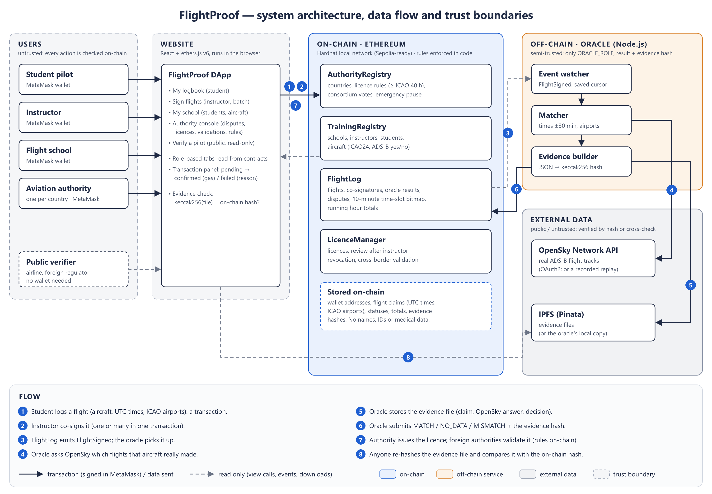
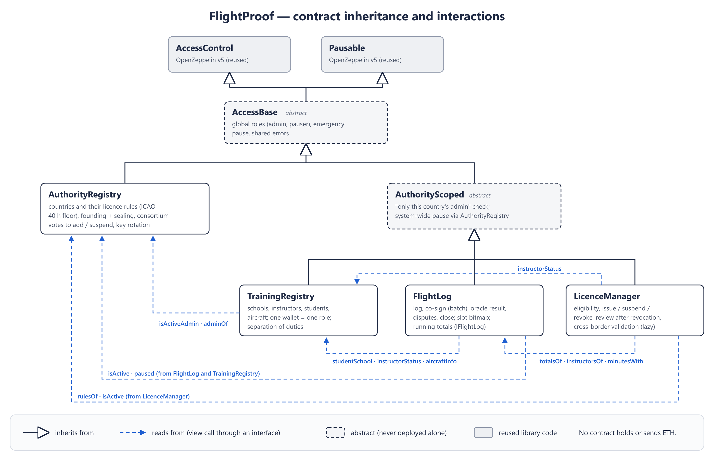

# FlightProof architecture

Material for the architecture, security and gas sections of the report.

## 1. Components and data flow





The diagrams are drawn as SVG in `docs/diagrams/` (the PNGs are rendered from them). A text version
of the flow follows.

```
 Student / Instructor / School / Authority (MetaMask)
        │  transactions                          ▲ reads (status, totals, licences)
        ▼                                        │
 ┌──────────────────── Ethereum (Hardhat local / Sepolia) ────────────────────┐
 │ AuthorityRegistry ◄── TrainingRegistry ◄── FlightLog ◄── LicenceManager     │
 └───────────────────────────────┬────────────────────────▲───────────────────┘
          FlightSigned event     │                        │ submitVerification(result, hash, uri)
                                 ▼                        │
                        ┌─────────────────── Oracle service (Node.js) ──────┐
                        │ matcher ◄── OpenSky /flights/aircraft (OAuth2)     │
                        │ evidence JSON ──► IPFS (Pinata) + local copy       │
                        └────────────────────────────────────────────────────┘
```

1. The student logs a flight (`logFlight`). The instructor co-signs it (`signFlight`).
2. `FlightSigned` carries everything the oracle needs (aircraft ICAO24, times, airports).
3. The oracle asks OpenSky which flights that aircraft made around that time, decides, stores the
   evidence file and submits the result with `keccak256(evidence)`.
4. Counted flights update the student's running totals. `LicenceManager` reads the totals.

## 2. Flight state machine (FlightLog)

```
Logged ──instructor signs (≤7 days)──► Signed ──oracle MATCH──────► Verified  (counts, ADS-B confirmed)
   │                                     │  ──oracle NO_DATA────► Attested  (counts; aircraft has no ADS-B)
   │                                     │  ──oracle MISMATCH───► Mismatch ──student disputes (≤30 days)──► Disputed
   │                                     │                                       authority accepts ──► Attested
   │                                     │                                       authority rejects ──► Rejected
   │                                     └──oracle silent 14 days, student claims──► Attested
   └── unsigned after 7 days ─┐
       Mismatch after 30 days ├── anyone calls closeFlight ──► Closed (time slots freed)
       Rejected ──────────────┘
```

Licence status (LicenceManager, computed when read):
`Active` → `UnderReview` (a signing instructor was revoked and the authority has not re-checked)
→ `Suspended` / `Revoked` (home authority) → `AuthoritySuspended` (consortium suspended the issuer).

## 3. Contracts and why they are split this way

| Contract | Responsibility | Calls |
|---|---|---|
| `AccessBase` (abstract) | Roles, emergency pause, shared errors | — |
| `AuthorityScoped` (abstract, is AccessBase) | Link to AuthorityRegistry, "only this country's admin" check, system-wide pause | AuthorityRegistry |
| `AuthorityRegistry` (is AccessBase) | Authorities, rule sets (ICAO floor enforced), consortium votes | — |
| `TrainingRegistry` (is AuthorityScoped) | Schools, instructors, students, aircraft; one wallet = one role | AuthorityRegistry |
| `FlightLog` (is AuthorityScoped) | Flights, signing, oracle results, disputes, time slots, running totals | TrainingRegistry, AuthorityRegistry |
| `LicenceManager` (is AuthorityScoped) | Eligibility, licences, cross-border validation, review clearing | FlightLog, TrainingRegistry, AuthorityRegistry |

**Why inheritance:** every contract needs the same roles, pause and checks. Writing them once in a
two-level chain (`AccessBase` → `AuthorityScoped`) avoids copy-paste bugs, and pausing the
AuthorityRegistry stops all contracts at once.
**Why composition (separate contracts):** each has one job and its own storage; contracts talk
through small interfaces (`IAuthorityRegistry`, `ITrainingRegistry`, `IFlightLog`), so each can be
tested and explained by one team member.

## 4. On-chain vs off-chain data

| Data | Where | Why |
|---|---|---|
| Wallet addresses (pseudonymous IDs), roles, statuses | On-chain | Shared truth all parties must agree on |
| Flight claim: aircraft id, UTC times, duration, ICAO airport codes, flags | On-chain | Must be tamper-evident; small |
| Hour totals per student, licence and validation status | On-chain | Read by every verifier |
| Evidence hash (`bytes32`) | On-chain | Proves which evidence the oracle used |
| Evidence JSON (claim + OpenSky query + answer + decision) | IPFS + oracle `state/` | Large; content-addressed; ADS-B data is public |
| Evidence and dispute links (`ipfs://…`) | Event logs only | Cheaper than storage; indexers can read them |
| Names, ID numbers, medical certificates, photos | Off-chain (school/authority systems), **never** on-chain | Privacy laws (e.g. GDPR "right to be forgotten") |
| OpenSky API secret, oracle key | Oracle `.env` only | Secrets never go on-chain or in the repo |

## 5. Trust boundaries and failure handling

| Boundary | Risk | Handling |
|---|---|---|
| Wallet → contracts | Anyone can send transactions | Role and scope checks on every write; custom errors |
| Oracle → FlightLog | Oracle key stolen or bribed | Only `ORACLE_ROLE`; cannot report `NO_DATA` for ADS-B aircraft; evidence hash on-chain; students can dispute; authority decides |
| OpenSky → oracle | Outage, rate limit, no coverage | Retry on next poll; pending work saved to disk; 14-day fallback to `Attested`; licence rules cap unverified hours (60% must be ADS-B verified) |
| IPFS → verifiers | File unavailable or altered | Local copy kept; anyone can check `keccak256(file)` against the on-chain hash |
| Authority → system | Corrupt or rogue regulator | Contract enforces rules even for the regulator; ICAO floor; consortium can suspend an authority |

## 6. Threat model

**Assets:** honest flight hours, valid licences, trust in validations, oracle results, privacy, availability.
**Actors:** students, instructors, schools, authorities, the oracle operator, outside attackers, verifiers (read-only).

| # | Threat | Control | Test |
|---|---|---|---|
| T1 | Ghost flight (student + instructor collude) | ADS-B cross-check; `NO_DATA` forbidden for tracked aircraft | `Attack scenarios 1` |
| T2 | Two students claim the same aircraft/time | 10-minute slot bitmap per aircraft and per student | `Attack scenarios 2`, `time-slot protection` |
| T3 | Corrupt instructor's hours keep counting | Revocation → `UnderReview` until the authority re-checks (lazy, no loops) | `Attack scenarios 3` |
| T4 | Fake oracle results | `ORACLE_ROLE`, evidence required, disputes | `Attack scenarios 4`, `oracle` tests |
| T5 | Regulator issues licences without hours / lowers rules | Eligibility enforced in `issueLicence`; ICAO floor in rules | `Attack scenarios 5`, `rule validation` |
| T6 | One country acts on another's people | `AuthorityScoped` checks per authority id | `Attack scenarios 6`, `authority scope` |
| T7 | Unbounded loop makes licence checks fail (DoS) | Max 10 instructors per student | `Attack scenarios 7` |
| T8 | Fake claims block real flights forever (griefing) | `closeFlight` frees slots of dead claims | `Attack scenarios 1`, `closing dead flights` |
| T9 | Self-signing | One wallet = one role; instructors registered by the authority only | `one wallet, one role`, `separation of duties` |
| T10 | Emergency (bug found, key stolen) | System-wide pause via `PAUSER_ROLE` | `emergency pause`, `Attack scenarios 8` |
| T11 | Oracle transaction collisions | `NonceManager` in the oracle (found in testing) | end-to-end run |

**Reentrancy:** the contracts hold and send no ETH or tokens, so there is no external call that hands
control to an attacker. Calls between FlightProof contracts are `view` calls. State is updated before
events are emitted. This is why no `ReentrancyGuard` is used; say so explicitly in the report.

## 7. Gas: what is optimized, and what the baseline should be

Measure with `npm run gas` using the **same inputs** for baseline and optimized versions.

| # | Optimization (implemented) | Baseline to write for comparison |
|---|---|---|
| G1 | `Flight` packed into 3 slots (`uint40` times, `uint16` duration, `uint8` flags, `bytes4` airports) | Every field `uint256`, airports as `string` |
| G2 | Running totals: `issueLicence` reads one slot | Loop over all of the student's flights in `issueLicence` |
| G3 | Time slots as a 144-bit bitmap per day (1-2 storage words per flight) | `mapping(aircraft => mapping(slot => bool))`, one write per 10-minute slot |
| G4 | `signFlights` batch | Separate `signFlight` calls |
| G5 | Evidence URI in events only; `bytes32` hash in storage | Store the URI `string` in the `Flight` struct |
| G6 | Lazy validity (licence/validation status computed on read) | Loop over all validations when a licence is suspended |
| G7 | Custom errors instead of `require` strings | `require(cond, "long message")` |

Suggested report table (fill with your measurements):
`operation | baseline gas | optimized gas | % change | method | trade-off`.
Trade-offs to discuss: packed types are harder to read; `bytes4` needs conversion in the UI;
10-minute slots can reject a flight that truly starts in the same 10 minutes another one ended.

## 8. Known limitations

- ADS-B proves the **aircraft** flew, not **who** flew it. The instructor's signature covers the person.
- OpenSky coverage is uneven worldwide; small aircraft often lack ADS-B. Mitigated by the verified-share rule.
- A single oracle operator is a trust point (stretch goal: 2-of-3 oracles).
- Real regulators would need legal agreements and would likely use a permissioned consortium chain.
- Flight times are rounded to 10-minute slots for overlap checks.
