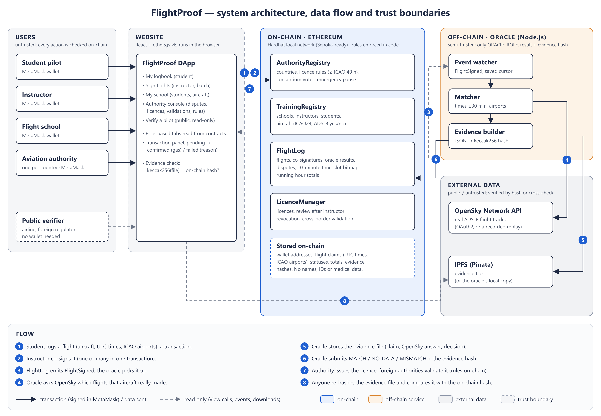
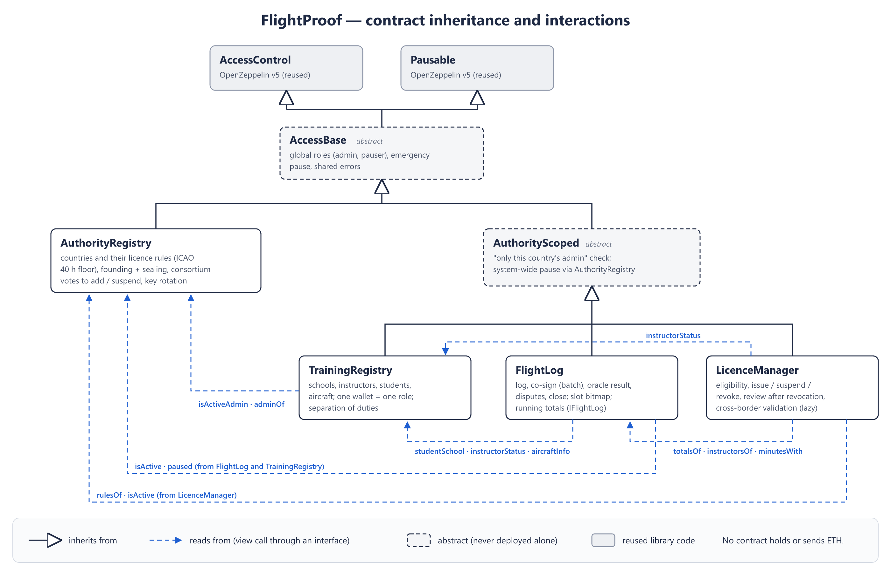

# FlightProof: A Verified Pilot Training Logbook on Ethereum

**Blockchain Empowerment Project, Fall 2026**

| Member | Roll number |
|---|---|
| [Member 1 name] | [roll number] |
| [Member 2 name] | [roll number] |

Repository: https://github.com/Hefty-I/Flight-LogBook

---

## 1. Introduction

FlightProof is a decentralized application (DApp) that makes pilot training hours **verifiable**.
Student pilots log their flights, instructors co-sign them, and an oracle checks every flight
against **real aircraft tracking data** (ADS-B data from the OpenSky Network). Aviation
authorities from different countries issue licences only when the on-chain logbook meets their
rules, and any other authority can **validate** a foreign licence against its own rules, directly
from the shared record, without trusting a PDF.

## 2. Problem and justification

### 2.1 The problem

Pilot logbooks are **self-reported**. The hours that a licence is built on are written down by the
student and signed by an instructor or school, and they are rarely cross-checked. This has been
abused at scale in several countries:

| Country | What happened |
|---|---|
| Pakistan (2020) | A government review found 262 of 860 active pilots held "dubious" licences or had cheated on exams. EASA then suspended PIA's authorisation to fly to the EU and asked member states to review Pakistani licence validations. |
| India (2011–2017) | A flying school's chief flight instructor faked trainees' flying hours (19 cases, 14 licences suspended). Three DGCA officials were arrested in a related licensing scam. DGCA's response was to cross-check logbooks by hand against air traffic control logs and fuel bills. |
| USA (2026) | The FAA issued an emergency order revoking StarFlite Aviation's air carrier certificate, alleging falsified training records for at least 10 pilots and unqualified pilots on at least 170 flights. |
| USA (earlier) | A pilot (Al-Daous) logged about 90 hours he never flew; his licence was revoked and he was convicted. |

Two lessons shape the design:

1. **The fix that works is an independent cross-check** (India compared logbooks with ATC data by
   hand). FlightProof automates that cross-check with public ADS-B data.
2. **The regulator itself can be part of the problem** (Pakistan's authority issued the licences;
   DGCA officials were arrested). So the system must not depend on trusting any single authority.

### 2.2 Why a blockchain

- **Many parties who do not fully trust each other** need one shared record: students, instructors,
  schools, national authorities, foreign authorities and airlines.
- **No single owner can quietly edit history.** A regulator-run database would still require
  everyone else to trust that regulator, which is exactly what failed in the cases above.
- **Rules are enforced in code, even against the regulator.** A licence cannot be issued unless the
  logbook meets the authority's rules, and rules cannot be set below the ICAO minimum of 40 hours.
- **Cross-border verification without paperwork.** A foreign authority reads the same verified
  record instead of a scanned logbook.

### 2.3 What stays off-chain

Personal data (names, ID numbers, medical certificates), raw tracking data, and documents stay
off-chain. Only pseudonymous wallet addresses, flight claims, statuses, totals and hashes are stored
on-chain (see the data map in Section 6.3). This also keeps the system compatible with privacy laws
such as the GDPR "right to be forgotten", because personal data can still be deleted off-chain.

## 3. Use case: roles and workflows

### 3.1 Roles

| Role | What they do |
|---|---|
| Authority admin (one per country) | Registers schools and instructors, revokes instructors, resolves disputes, issues and suspends licences, decides validation requests, sets its own licence rules |
| Authority consortium | Votes to admit a new authority or suspend a rogue one (strict majority) |
| Flight school admin | Registers its students and aircraft (with the aircraft's ICAO24 transponder address) |
| Instructor | Co-signs students' flights (single or batch) |
| Student pilot | Logs flights, disputes oracle mismatches, requests foreign validation |
| Oracle service | Checks signed flights against OpenSky data and posts the result with an evidence hash |
| Public verifier (airline, foreign regulator) | Reads a pilot's licence, hours and evidence without a wallet |

### 3.2 Flight lifecycle (FlightLog state machine)

```
Logged ──instructor signs (≤ 7 days)──► Signed ──oracle MATCH────► Verified  (counts, ADS-B confirmed)
   │                                       │  ──oracle NO_DATA──► Attested  (counts; aircraft has no ADS-B)
   │                                       │  ──oracle MISMATCH─► Mismatch ──student disputes (≤ 30 days)──► Disputed
   │                                       │                                     authority accepts ──► Attested
   │                                       │                                     authority rejects ──► Rejected
   │                                       └── oracle silent 14 days, student claims ──► Attested
   └── unsigned after 7 days ┐
       Mismatch after 30 days ├── anyone calls closeFlight ──► Closed (time slots released)
       Rejected ─────────────┘
```

### 3.3 Licence and validation lifecycle

- A licence is issued by the **home authority** (the authority of the student's school) only if the
  student's totals meet its rules: total, dual, solo and cross-country hours, and a minimum share of
  **ADS-B-verified** hours (60% in the demo).
- The **effective** licence status is computed when it is read: `Active`, `Under review` (a signing
  instructor was revoked and the hours have not been re-checked), `Suspended`, `Revoked`, or
  `Issuing authority suspended`.
- A pilot can ask a **foreign authority** to validate the licence. The foreign authority can approve
  only if the same logbook meets **its own** rules (e.g. 40 h passes FAA-style rules but not 45 h
  EASA-style rules). An approved validation automatically shows "Home licence inactive" if the home
  licence is later suspended.

## 4. System architecture

### 4.1 Components



Figure 1 shows the components, the numbered flow of a flight from logging to verification, and the
trust boundaries: users are untrusted (every action is checked on-chain), the oracle is semi-trusted
(only `ORACLE_ROLE`, and every result carries an evidence hash), and external data is public and
verified by hash or cross-check.

### 4.2 Technology

| Layer | Technology |
|---|---|
| Smart contracts | Solidity 0.8.24, Hardhat 2, OpenZeppelin Contracts v5 (AccessControl, Pausable) |
| Tests | Hardhat + Mocha/Chai, network helpers for time travel; Node's built-in test runner for the oracle |
| Oracle | Node.js 22, ethers v6, OpenSky Network REST API (OAuth2 client credentials), Pinata IPFS (optional) |
| Website | React 18, Vite, ethers v6, MetaMask |

## 5. Smart contracts

### 5.1 Inheritance and composition



**Why inheritance:** every contract needs the same roles, pause switch and checks. Writing them once
in a two-level chain (`AccessBase` → `AuthorityScoped`) avoids copy-paste bugs. Because
`AuthorityScoped` also checks the AuthorityRegistry's pause flag, **one switch stops the whole
system**.

**Why composition (separate contracts):** each contract has one job and its own storage. Contracts
talk through small interfaces (`IAuthorityRegistry`, `ITrainingRegistry`, `IFlightLog`), so each can
be tested, explained and owned by one team member.

### 5.2 The contracts

| Contract | Responsibility | Key functions |
|---|---|---|
| `AuthorityRegistry` | Authorities, licence rules (ICAO 40 h floor enforced), consortium voting, key rotation | `addFoundingAuthority`, `sealGenesis`, `proposeAuthority`, `proposeSuspension`, `vote`, `updateRules` |
| `TrainingRegistry` | Schools, instructors, students, aircraft; one wallet = one role; separation of duties | `registerSchool`, `registerInstructor`, `revokeInstructor`, `registerStudent`, `registerAircraft` |
| `FlightLog` | Flight claims, co-signing, oracle results, disputes, time-slot protection, running totals | `logFlight`, `signFlight`, `signFlights`, `submitVerification`, `openDispute`, `resolveDispute`, `closeFlight` |
| `LicenceManager` | Eligibility, licences, review after instructor revocation, cross-border validation | `issueLicence`, `suspendLicence`, `clearReview`, `requestValidation`, `decideValidation` |

### 5.3 Contract-to-contract interactions

- `TrainingRegistry` asks `AuthorityRegistry` whether the caller is the active admin of an authority.
- `FlightLog` asks `TrainingRegistry` about the student's school, the instructor's status and the
  aircraft (ICAO24, ADS-B), and asks `AuthorityRegistry` whether the authority is active.
- `LicenceManager` reads the student's totals and instructors from `FlightLog`, instructor status from
  `TrainingRegistry`, and the rules from `AuthorityRegistry`.
- All cross-contract calls are `view` calls. No contract holds or sends ETH or tokens.

### 5.4 Notable design decisions

- **Separation of duties:** authorities register instructors (who hold an authority-issued rating);
  schools register only their own students and aircraft. A corrupt school cannot invent instructors.
- **Founding then sealing:** the deployer adds the founding authorities and then calls
  `sealGenesis()`. After that, only a majority vote of authorities can change membership.
- **Lazy status:** revoking an instructor or suspending a licence does not loop over flights or
  validations. The effective status is computed when read, so these actions cost the same no matter
  how many pilots or countries are affected.

## 6. On-chain / off-chain integration

### 6.1 The oracle

1. Watches `FlightLog` for `FlightSigned` events (chunked block ranges, cursor saved to disk).
2. Asks OpenSky which flights that aircraft (ICAO24) made between 2 h before take-off and 2 h after
   landing.
3. Decides: **MATCH** if take-off and landing are each within 30 minutes and OpenSky's estimated
   airports agree (unknown airports are not a mismatch); **MISMATCH** if an ADS-B-equipped aircraft
   left no matching track; **NO_DATA** only for aircraft without ADS-B.
4. Builds an evidence JSON (claim, exact OpenSky query and answer, decision), hashes it with
   keccak256, stores it on IPFS (Pinata) or locally, and calls `submitVerification(id, result, hash, uri)`.

### 6.2 Trust, integrity and failure handling

| Boundary / risk | Handling |
|---|---|
| Oracle key stolen or bribed | Only `ORACLE_ROLE` can submit; the contract **rejects NO_DATA for ADS-B aircraft**, so a lazy or bribed oracle cannot wave fake flights through; students can dispute; the authority decides |
| Evidence altered after the fact | The keccak256 hash is stored on-chain. The website's "Check evidence" button downloads the file, recomputes the hash and shows whether it matches |
| OpenSky outage, rate limit, no coverage | Retries on the next poll; pending work survives restarts; after 14 days the student can fall back to "Attested"; licence rules require a minimum share (60%) of ADS-B-verified hours |
| OpenSky processes flights overnight | Live mode waits 24 h after landing before checking |
| Transaction collisions | The oracle uses ethers' `NonceManager` (a bug found and fixed during testing) |

### 6.3 Data map

| Data | Where | Why |
|---|---|---|
| Wallet addresses, roles, statuses | On-chain | Shared truth all parties must agree on |
| Flight claim: aircraft id, UTC times, duration, ICAO airport codes, flags | On-chain | Must be tamper-evident; small |
| Hour totals, licence and validation status | On-chain | Read by every verifier |
| Evidence hash (bytes32) | On-chain | Proves which evidence the oracle used |
| Evidence JSON | IPFS / oracle storage | Large; content-addressed; ADS-B data is public |
| Evidence and dispute links | Event logs only | Cheaper than storage; indexers read them |
| Names, ID numbers, medical data | Off-chain only, never on-chain | Privacy |
| OpenSky secret, oracle key | Oracle `.env` only (never committed) | Secrets |

## 7. Website (DApp frontend)

- **Wallet:** MetaMask connection, account and network change detection, one-click switch to the
  local Hardhat network. Without MetaMask the site works in read-only mode.
- **Role-dependent UI:** roles are read **from the contracts** (no backend login), and each role only
  sees its own tabs: *My logbook* (student), *Sign flights* (instructor), *My school*, *Authority*.
- **Transaction feedback:** every transaction shows *Confirm in MetaMask → Pending → Confirmed (block,
  gas used)* or *Failed* with a plain-language reason decoded from the contract's custom errors
  (e.g. "This aircraft is already booked for an overlapping time").
- **Pages:** student progress bars and flight form with the same checks as the contract; instructor
  sign queue with batch signing; school registration of students and aircraft; authority console
  (disputes, licences, validations, schools, instructors, rules).
- **Off-chain feature:** the public *Verify a pilot* page (shareable `?pilot=0x…` link) shows the
  licence, verified hours, recognition by each authority, and a **Check evidence** button that
  verifies the oracle's evidence file against the on-chain hash and shows what OpenSky saw.

## 8. Gas optimization

The full sheet is in `docs/GAS_RESULTS.md` and is regenerated by `npm run gas:compare`.

### 8.1 Method

A naive `BaselineFlightLog` enforces the same rules written the "obvious" way. A script runs
**identical flights** through both versions (same compiler and optimizer settings, same network,
signers, inputs and order, shared registries) and records `gasUsed` from every receipt.

### 8.2 Results

| Operation | Baseline gas | Optimized gas | Change |
|---|---|---|---|
| logFlight, 2-hour flight (avg of 20) | 834,618 | 151,401 | −81.9% |
| logFlight, 1-hour flight (avg of 40) | 561,222 | 150,546 | −73.2% |
| logFlight, 10-hour flight | 3,032,932 | 150,598 | −95.0% |
| signFlight (avg of 60) | 84,127 | 66,695 | −20.7% |
| submitVerification (avg of 60) | 153,702 | 83,242 | −45.8% |
| issueLicence after 20 flights | 296,597 | 87,999 | −70.3% |
| issueLicence after 40 flights | 509,100 | 87,999 | −82.7% |
| Sign 5 flights: 5 × signFlight vs signFlights(5) | 387,538 | 128,206 | −66.9% |
| FlightLog deployment (one-time) | 2,406,663 | 2,787,194 | +15.8% |

### 8.3 Optimizations

| # | Optimization | Effect |
|---|---|---|
| G1 | `Flight` struct packed into 3 storage slots (`uint40`, `uint16`, `uint8` flags, `bytes4` airports) | Fewer storage writes per flight |
| G2 | Running totals updated when a flight starts to count | `issueLicence` is constant-cost (88k) instead of growing with every flight |
| G3 | A day's 144 ten-minute slots stored as bits of one `uint256` | A 10-hour flight writes 1–2 words instead of 120 slots (−95%) |
| G4 | `signFlights` batch | −66.9% for 5 flights |
| G5 | Evidence URI only in events; hash stored | Cheaper verification |
| G6 | Lazy licence/validation status | Suspensions never loop over validations |
| G7 | Custom errors | Smaller code, cheaper failures |

### 8.4 Trade-offs

Packed types and bitmaps are harder to read; running totals move a little cost into verification;
flights are rounded to 10-minute slots; evidence links live only in event logs; and the optimized
contract costs 15.8% more to **deploy** because it also contains features the baseline lacks
(disputes, timeouts, closing, batch signing). That is a one-time cost, while the savings apply to
every flight.

## 9. Security

### 9.1 Threat model

**Assets:** honest flight hours, valid licences, trust in validations, oracle results, privacy,
availability. **Actors:** students, instructors, schools, authorities, the oracle operator, outside
attackers, read-only verifiers. **Trust boundaries:** wallet → contracts, oracle → FlightLog,
OpenSky → oracle, IPFS → verifiers, authority → system (Section 6.2).

| # | Threat | Control | Test evidence |
|---|---|---|---|
| T1 | Ghost flight (student and instructor collude) | ADS-B cross-check; NO_DATA forbidden for tracked aircraft | Attack scenario 1 |
| T2 | Two students claim the same aircraft at the same time | Time-slot bitmap per aircraft and per student | Attack scenario 2; time-slot tests |
| T3 | A corrupt instructor's hours keep counting | Revocation → "Under review" until the authority re-checks | Attack scenario 3 |
| T4 | Fake oracle results | `ORACLE_ROLE`, evidence required, disputes | Attack scenario 4; oracle tests |
| T5 | Regulator issues licences without hours or lowers rules | Eligibility enforced in `issueLicence`; ICAO floor | Attack scenario 5; rule tests |
| T6 | One country acts on another's people | `AuthorityScoped` checks per authority id | Attack scenario 6; scope tests |
| T7 | Unbounded loop makes licence checks fail (DoS) | Max 10 instructors per student | Attack scenario 7 |
| T8 | Fake claims block real flights forever (griefing) | `closeFlight` frees slots of dead claims | Attack scenario 1; closing tests |
| T9 | Self-signing | One wallet = one role; authority registers instructors | Registry tests |
| T10 | Emergency (bug, stolen key) | System-wide pause (`PAUSER_ROLE`) | Pause tests; attack scenario 8 |

### 9.2 Controls applied

Role-based authorization (OpenZeppelin AccessControl plus per-authority scope checks), input and
state validation with custom errors, strict state machines, time windows, bounded loops, and an
emergency pause. **Reentrancy:** the contracts hold and send no ETH or tokens, and all calls between
FlightProof contracts are `view` calls, so no external call can hand control to an attacker. State
is updated before events are emitted. For this reason no `ReentrancyGuard` is needed.

### 9.3 Demonstrated live in the website

- Logging an overlapping flight fails with "This aircraft is already booked for an overlapping time."
- An authority issuing a licence to a pilot with 1 h 30 m fails with "Not eligible: Total hours too low."
- Lowering the rules to 10 hours fails with "Rules cannot be below the ICAO minimum of 40 hours."

## 10. Testing

### 10.1 Automated tests

| Suite | Tests | Covers |
|---|---|---|
| AuthorityRegistry | 13 | founding, sealing, voting (majority, double votes, deadline), suspension, rule validation (exactly 40 h passes, 1 minute less fails), key rotation |
| TrainingRegistry | 11 | authority scope, separation of duties, one wallet one role, aircraft uniqueness, school status |
| FlightLog | 23 | normal flow, boundaries (1/720/721 minutes, exactly 3 days, 7-day sign window, 14-day timeout, 30-day dispute), midnight-crossing flights, batch signing, oracle rules, disputes, closing, pause |
| LicenceManager | 11 | A vs B rules on the same logbook, exactly 60% ADS-B verified passes and 1 minute less fails, status transitions, consortium suspension, cross-border validation, lazy validity |
| Attack scenarios | 8 | the eight project-specific attacks in Section 9.1 |
| Oracle (Node) | 14 | matching rules and tolerance boundary, airports, no-data cases, fixture client, live client with a fake server, evidence hashing and storage |
| **Total** | **80** | all passing |

### 10.2 End-to-end checks

On a local chain: deploy → seed → oracle → status. The real demo flight became **Verified** and the
ghost flight **Mismatch**. In the browser: a student logged flights (overlap rejected, valid flight
confirmed), an instructor batch-signed, the oracle marked the new flight as a mismatch, the student
disputed it, and the authority rejected the dispute. The public verify page confirmed that an
evidence file matches its on-chain hash.

## 11. Deployment and reproducibility

```
cd contracts && npm install && npx hardhat test                 # 66 tests
cd oracle && npm install && npm test                            # 14 tests
cd contracts && $env:DEMO_START_DATE="2026-11-20T12:00:00Z"; npx hardhat node
cd contracts && npm run deploy:local && npm run seed:local
cd oracle && npm run once                                       # needs oracle/.env (see .env.example)
cd frontend && npm install && npm run dev                       # http://localhost:5173
cd contracts && npm run gas:compare                             # regenerates docs/GAS_RESULTS.md
```

No private keys or seed phrases are committed: only `.env.example` files are in the repository, and
local demo wallets are Hardhat's public test accounts. The contracts are Sepolia-ready
(`npm run deploy:sepolia` with an RPC URL and a funded test key in `contracts/.env`).

## 12. Limitations and future work

- ADS-B proves the **aircraft** flew, not **who** flew it; the instructor's signature covers the person.
- OpenSky coverage is uneven and many light aircraft lack ADS-B; mitigated by the verified-share rule.
- The demo uses a **synthetic** OpenSky recording in the exact API format. The live OpenSky client and
  the Pinata upload are unit-tested against fake servers but were not run against the real services.
- A single oracle operator is a trust point; future work: 2-of-3 independent oracles.
- Real regulators would need legal agreements and would likely run a permissioned consortium chain.
- Flights are rounded to 10-minute slots for overlap checks.
- Not deployed to a public testnet within the project time.

## 13. Work distribution

| Member | Owned work | Evidence (commits / tests / demo) | Effort and justification |
|---|---|---|---|
| [Member 1] | Base contracts (`AccessBase`, `AuthorityScoped`, interfaces), `AuthorityRegistry`, `TrainingRegistry`, `LicenceManager`; their tests (rule, scope and licence security cases); gas study (baseline contract and measurement script); authority, school and verify pages | Contract, test and gas commits; 35 contract tests; gas sheet; demo: authority console, "corrupt regulator" refusal, cross-border validation, evidence check | Four contracts including consortium voting, cross-border validation and the inheritance chain, plus the gas study |
| [Member 2] | `FlightLog` and its tests; the 8 attack scenarios and threat model; oracle service (OpenSky client, matcher, evidence hashing, IPFS); deploy, seed and status scripts; website foundation, student and instructor pages; README and architecture docs | FlightLog, attack-test, oracle, scripts and website commits; 31 contract tests + 14 oracle tests; demo: logging, signing, oracle verification, attack scenarios | The largest contract (state machine, time slots, disputes) and the off-chain integration (OpenSky, IPFS, chain events) |

**Justification of the split:** security work is shared rather than given to one person. Member 1
owns the rule, scope and regulator-side protections, and Member 2 owns the flight-level attacks.
Integration is also shared: Member 2 built the oracle, and Member 1 built the pages that verify its
evidence. Both members prepared the report and the demo together, and each can explain the files
they own in the viva.

*Fill in the real names, and adjust the split to what each member actually did.*

## 14. Attribution

- **Reused code:** OpenZeppelin Contracts v5 (MIT) for `AccessControl` and `Pausable`. All other
  contract logic is original to this project.
- **Libraries and tools:** Hardhat, ethers.js v6, React, Vite, Node.js.
- **Data:** OpenSky Network (ADS-B data, research/non-commercial use).
- **AI assistance:** parts of the code and documentation were drafted with an AI assistant (Claude)
  and reviewed, tested and committed step by step by the team. [Adjust this statement to your
  course's policy.]

## References

1. Dawn, "PIA banned from flying to EU states for six months" (2020). https://www.dawn.com/news/1566153
2. Al Jazeera, "EU agency suspends Pakistani airline flights over safety concerns" (2020). https://www.aljazeera.com/news/2020/6/30/eu-agency-suspends-pakistani-airline-flights-over-safety-concerns
3. Deccan Herald, "Three pilots grounded for fudging flying hours". https://www.deccanherald.com/india/three-pilots-grounded-fudging-flying-2532480
4. Lok Sabha answer on fake flying hours, Rajasthan Flying School. https://eparlib.nic.in/bitstream/123456789/660223/1/14820.pdf
5. FAA, "FAA Issues Emergency Order to Immediately Revoke the Air Carrier Certificate of StarFlite Aviation" (2026). https://www.faa.gov/newsroom/faa-issues-emergency-order-immediately-revoke-air-carrier-certificate-starflite-aviation
6. FBI Omaha, "Waterloo Man Pleads Guilty to Making False Statements to the FAA" (2012). https://www.fbi.gov/omaha/press-releases/2012/waterloo-man-pleads-guilty-to-making-false-statements-to-the-faa
7. ICAO, "Council adopts amendments supporting electronic pilot licenses" (Annex 1, Amendment 178). https://www.icao.int/Newsroom/Pages/ICAO-Council-adopts-amendments-supporting-electronic-pilot-licenses-flight-operations-continuing-airworthiness-responsibili.aspx
8. 14 CFR 61.109, Aeronautical experience (private pilot). https://www.ecfr.gov/current/title-14/chapter-I/subchapter-D/part-61/subpart-E/section-61.109
9. EASA, Licensing for general aviation. https://www.easa.europa.eu/easa-and-you/general-aviation/licensing-general-aviation/
10. OpenSky Network REST API documentation. https://openskynetwork.github.io/opensky-api/rest.html
11. OpenZeppelin Contracts. https://github.com/OpenZeppelin/openzeppelin-contracts
